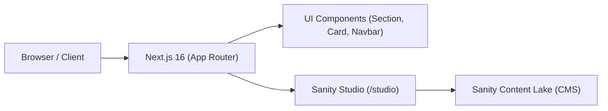

# Kodeva — Landing Campaign, Blog & Mini Marketplace

[Link deploy] | [Link CMS admin](/studio) | [Link repo]

## 1. Waktu Pengerjaan

| Bagian                    | Estimasi | Aktual    |
| ------------------------- | -------- | --------- |
| Setup & CMS                                       | 1 jam    | 1 jam     |
| Landing + Blog                                    | 1 jam    | 1 jam     |
| Integrasi CMS ke Landing + Blog & Validasi Error  |          |           |
| Marketplace                                       |          |           |
| Tracking, UTM, Lighthouse |          |           |
| Dokumentasi               |          |           |
| **Total**                 |          | **2 jam** |

## 2. Akun Demo

| Peran     | URL       | Email | Password       |
| --------- | --------- | ----- | -------------- |
| CMS admin | `/studio` |       | (Sanity Login) |

## 3. Cara Menjalankan di Lokal

- Prasyarat: Node.js (>= 18.x atau 20.x), npm
- `git clone <repo-url>`
- `cp .env.example .env` (atau buat file `.env`):
  - `NEXT_PUBLIC_SANITY_PROJECT_ID`: f3djuv8n
  - `NEXT_PUBLIC_SANITY_DATASET`: Dataset Sanity `kodeva_local`
  - `NEXT_PUBLIC_SANITY_API_VERSION`: Versi API Sanity (`2026-10-29`)
  - `NEXT_PUBLIC_APP_NAME`: Nama Brand/Aplikasi (default: `Kodeva`)
- `npm install`
- `npm run dev`
- Akses website di `http://localhost:3000`
- Akses CMS Studio di `http://localhost:3000/studio`
- Cara menjalankan test:
- Cara seed data dummy (jika ada):

## 4. Arsitektur & Alasan Memilih Stack

- Diagram singkat (ASCII/Mermaid):



- Tabel keputusan:

| Kebutuhan              | Pilihan                             | Alasan                                                               | Alternatif yang dipertimbangkan |
| ---------------------- | ----------------------------------- | -------------------------------------------------------------------- | ------------------------------- |
| Framework              | Next.js 16 (App Router)             | Server Components, performa tinggi, routing modern                   | Vite, Remix                     |
| CMS                    | Sanity CMS v3 (`next-sanity`)       | Schema as code, headless, fleksibel, embed studio di route `/studio` | Strapi, Contentful              |
| Database               | Sanity Content Lake                 | Terintegrasi langsung dengan CMS, query GROQ yang cepat              | PostgreSQL, MongoDB             |
| Hosting                |                                     |                                                                      |                                 |
| State management       |                                     |                                                                      |                                 |
| Mock API / data produk |                                     |                                                                      |                                 |
| UI library             | Tailwind CSS v4 + Custom Components | Kontrol penuh styling, performa tinggi tanpa runtime overhead        | Shadcn UI, Chakra UI            |

- Struktur folder (ringkas):

```text
kodeva/
├── app/
│   ├── studio/[[...tool]]/   # Sanity Studio Route
│   ├── globals.css           # Konfigurasi Tailwind CSS v4 & theme
│   ├── layout.tsx            # Root layout
│   └── page.tsx              # Landing page utama
├── components/
│   ├── Navbar.tsx            # Global Navbar (tema dark/light, glassmorphism)
│   ├── Section.tsx           # Global Section (tinggi 100vh / min-h-screen)
│   ├── Card.tsx              # Global Card (radius, border, background image/color)
│   └── Footer.tsx            # Global Footer (4 kolom navigasi & copyright)
└── sanity/
    ├── env.ts                # Environment helper Sanity
    ├── structure.ts          # Studio Desk structure builder
    └── schemaTypes/          # Skema data konten
        ├── postType.ts       # Schema artikel/post lengkap (validasi & SEO)
        ├── categoryType.ts   # Schema kategori
        ├── blockContentType.ts # Schema Portable Rich Text
        └── index.ts          # Registrasi semua skema
```

- Strategi caching/revalidation (ISR/on-demand revalidate via webhook),
  dan konsekuensinya: berapa detik/menit perubahan CMS tampil:
- Strategi SEO (meta, OG tags untuk WhatsApp, sitemap, structured data):
- Kesiapan multi-bahasa/multi-region (Malaysia & Singapura): i18n, mata uang, dsb.:
- Strategi performa mobile (image optimization, font, lazy load, dll.):

## 5. Asumsi

Tulis tiap hal yang ambigu + keputusan yang kamu ambil, contoh:
-

-
-
-

## 6. Status Pengerjaan

### ✅ Selesai

- [x] Setup Next.js 16 App Router & Tailwind CSS v4
- [x] Integrasi Sanity Studio CMS mounted di route `/studio`
- [x] Pembuatan Schema Sanity CMS (`postType`, `categoryType`, `blockContentType`) dengan validasi field & SEO
- [x] Pembuatan Komponen Global:
  - [x] `Section.tsx` (Auto 100vh / min-h-screen)
  - [x] `Card.tsx` (Fleksibilitas border, radius kustom, background image & overlay)
  - [x] `Navbar.tsx` (Tema dark/light, efek glassmorphism on-scroll, responsif mobile drawer)
  - [x] `Footer.tsx` (Brand bio, navigasi multi-kolom, copyright & terms)
- [x] Halaman Landing Page:
  - [x] Section 1: Hero Section (Gambar padang pasir, badge petualangan, judul 3 baris, pagination dots)
  - [x] Section 2: Article categories (3 kartu kategori: Travel, Adventure, Gear dengan tombol panah interaktif)
  - [x] Section 3: Newsletter (Kartu hitam dengan form input pill & mockup laptop perspektif 3D)
  - [x] Section 4: Footer

### ⚠️ Belum Selesai / Known Issues

- [ ] Integrasi CMS ke Landing Page + Blog (fetching dinamis konten Landing Page, halaman daftar artikel `/articles`, dan detail blog `/articles/[slug]`)
- [ ] Mini Marketplace (katalog produk, filter, sistem keranjang belanja / cart)
- [ ] Fitur Checkout & Alur Pembayaran
- [ ] Tracking analitik, dataLayer events, dan atribusi UTM
- [ ] Audit performa Google Lighthouse Mobile

### 🔜 Kalau Ada Waktu 1 Minggu Lagi

- [ ]
- [ ]

## 7. Library, Template & Tools Pihak Ketiga

| Nama               | Fungsi                     | Alasan dipakai                                                  |
| ------------------ | -------------------------- | --------------------------------------------------------------- |
| `next` (v16)       | Core Framework React       | App Router modern, Server & Client Components                   |
| `sanity` (v6)      | Headless CMS               | CMS fleksibel dengan konfigurasi skema berbasis kode TypeScript |
| `next-sanity`      | Integrasi Next.js & Sanity | Menyematkan Sanity Studio langsung di rute aplikasi Next.js     |
| `@sanity/vision`   | Plugin GROQ Playground     | Memudahkan pengujian query GROQ langsung di dalam Studio        |
| `@sanity/client`   | Sanity Data Client         | Pengambilan data konten dari Sanity Content Lake                |
| `tailwindcss` (v4) | Utility-first CSS          | Styling modern, responsif, cepat dan minim overhead             |

## 8. Rencana Integrasi Marketplace ke Backend

### Endpoint yang dibutuhkan

### Alur Payment Gateway yang Aman

### Menjaga Kuota Promo Tetap Akurat

### Pengiriman Lisensi Setelah Pembayaran

## 9. Lighthouse Mobile


- Skor Performance:
- Catatan optimasi yang dilakukan:

## 10. Bukti Tracking & UTM

## 11. Testing
