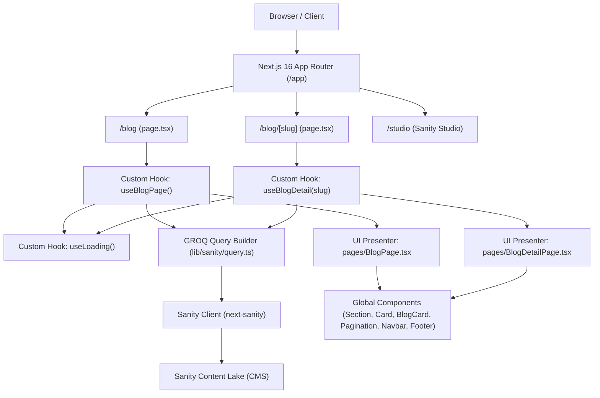

# Kodeva — Landing Campaign, Blog & Mini Marketplace

[Link deploy] | [Link CMS admin](/studio) | [Link repo]

## 1. Waktu Pengerjaan

| Bagian                                            | Estimasi | Aktual    |
| ------------------------------------------------- | -------- | --------- |
| Setup & CMS                                       | 1 jam    | 1 jam     |
| Landing Page UI Components                        | 1 jam    | 1 jam     |
| Integrasi CMS ke Blog, Dynamic Routing & Hooks    | 1 jam    | 1 jam     |
| Marketplace                                       |          |           |
| Tracking, UTM, Lighthouse                         |          |           |
| Dokumentasi                                       |          |           |
| **Total**                                         |          | **3 jam** |

## 2. Akun Demo

| Peran     | URL       | Email | Password       |
| --------- | --------- | ----- | -------------- |
| CMS admin | `/studio` |       | (Sanity Login) |

## 3. Cara Menjalankan di Lokal

- Prasyarat: Node.js (>= 18.x atau 20.x), npm
- `git clone <repo-url>`
- `cp .env.example .env` (atau buat file `.env`):
  - `NEXT_PUBLIC_SANITY_PROJECT_ID`: f3djuv8n
  - `NEXT_PUBLIC_SANITY_DATASET`: Dataset Sanity `kodeva_local`
  - `NEXT_PUBLIC_SANITY_API_VERSION`: Versi API Sanity (`2026-10-29`)
  - `NEXT_PUBLIC_APP_NAME`: Nama Brand/Aplikasi (default: `Kodeva`)
- `npm install`
- `npm run dev`
- Akses website di `http://localhost:3000`
- Akses halaman blog di `http://localhost:3000/blog`
- Akses CMS Studio di `http://localhost:3000/studio`
- Pengecekan tipe TypeScript: `npx tsc --noEmit`
- Linter kode: `npm run lint`

## 4. Arsitektur & Alasan Memilih Stack

- Diagram Arsitektur Aplikasi:



- Tabel keputusan:

| Kebutuhan              | Pilihan                             | Alasan                                                               | Alternatif yang dipertimbangkan |
| ---------------------- | ----------------------------------- | -------------------------------------------------------------------- | ------------------------------- |
| Framework              | Next.js 16 (App Router)             | Server & Client Components, performa tinggi, dynamic routes `[slug]` | Vite, Remix                     |
| CMS                    | Sanity CMS v3 (`next-sanity`)       | Schema as code, headless, fleksibel, embed studio di route `/studio` | Strapi, Contentful              |
| Database               | Sanity Content Lake                 | Terintegrasi langsung dengan CMS, query GROQ yang cepat & fleksibel  | PostgreSQL, MongoDB             |
| Query Builder          | Custom Fluent GROQ `Query` Builder  | Type-safe, chaining API mirip ORM (`where`, `orderBy`, `paginate`)   | Raw GROQ string manual          |
| State Management / UI  | Custom Hooks (`useLoading`, dll.)   | Pemisahan logika data dari komponen presentasi (*Clean Architecture*)| Redux, Zustand                  |
| UI library             | Tailwind CSS v4 + Custom Components | Kontrol penuh styling, performa tinggi tanpa runtime overhead        | Shadcn UI, Chakra UI            |

- Struktur folder:

```text
kodeva/
├── app/
│   ├── blog/
│   │   ├── [slug]/page.tsx   # Rute dinamis detail artikel blog
│   │   └── page.tsx          # Rute feed daftar artikel blog
│   ├── studio/[[...tool]]/   # Sanity Studio CMS
│   ├── globals.css           # Konfigurasi Tailwind CSS v4 & theme
│   ├── layout.tsx            # Root layout
│   └── page.tsx              # Landing page utama
├── components/
│   ├── BlogCard.tsx          # Kartu artikel responsif
│   ├── Card.tsx              # Kartu serbaguna (radius, border, bgImage)
│   ├── Footer.tsx            # Footer global 4 kolom
│   ├── Navbar.tsx            # Navbar dengan tema dark/light & mobile drawer
│   ├── Pagination.tsx        # Komponen navigasi pagination
│   └── Section.tsx           # Wrapper section dengan min-height responsif
├── enums/
│   └── card.enum.ts          # Enum opsi Card
├── hooks/
│   ├── useBlogDetail.ts      # Logika fetch detail artikel & artikel rekomendasi
│   ├── useBlogPage.ts        # Logika fetch feed artikel, pagination & sidebar
│   ├── useCard.ts            # Logika komputasi style Card
│   └── useLoading.ts         # Hook reusable untuk manajemen status loading/error UI
├── lib/
│   └── sanity/
│       ├── client.ts         # Inisialisasi Sanity Client
│       └── query.ts          # Fluent GROQ Query Builder
├── pages/
│   ├── BlogDetailPage.tsx    # Presenter view detail artikel & PortableText
│   └── BlogPage.tsx          # Presenter view feed artikel & sidebar
├── types/
│   ├── card.type.ts          # Interface props Card
│   ├── category.type.ts      # Interface skema & item kategori
│   ├── loading.type.ts       # Interface state & handler useLoading
│   ├── paginate.type.ts      # Interface Pagination
│   ├── post.type.ts          # Interface skema artikel, feed item, & detail item
│   └── sanity.type.ts        # Definisi tipe dokumen Sanity
└── sanity/
    ├── env.ts                # Helper env Sanity
    ├── structure.ts          # Desk structure Sanity Studio
    └── schemaTypes/          # Skema postType, categoryType, blockContentType
```

## 5. Status Pengerjaan

### ✅ Selesai

- [x] Setup Next.js 16 App Router & Tailwind CSS v4
- [x] Integrasi Sanity Studio CMS mounted di route `/studio`
- [x] Pembuatan Schema Sanity CMS (`postType`, `categoryType`, `blockContentType`) dengan validasi field & SEO
- [x] Pembuatan Komponen Global:
  - [x] `Section.tsx` (Auto 100vh / min-h-screen)
  - [x] `Card.tsx` (Fleksibilitas border, radius kustom, background image & overlay)
  - [x] `Navbar.tsx` (Tema dark/light, efek glassmorphism on-scroll, responsif mobile drawer)
  - [x] `Footer.tsx` (Brand bio, navigasi multi-kolom, copyright & terms)
- [x] Halaman Landing Page:
  - [x] Section 1: Hero Section (Gambar padang pasir, badge petualangan, judul 3 baris, pagination dots)
  - [x] Section 2: Article categories (3 kartu kategori dengan tombol panah interaktif)
  - [x] Section 3: Newsletter (Form input pill & mockup laptop perspektif 3D)
  - [x] Section 4: Footer
- [x] Integrasi CMS ke Blog & Dynamic Routing:
  - [x] Pembuatan Fluent GROQ Query Builder (`lib/sanity/query.ts`)
  - [x] Custom Hook `useLoading` untuk status loading, error handling, dan reset
  - [x] Halaman Blog Feed (`/blog`):
    - [x] Hero Card dinamis dari artikel featured terbaru
    - [x] Feed artikel dengan navigasi pagination interaktif
    - [x] Widget sidebar dinamis: Most Viewed & Categories
    - [x] Animasi skeleton loading pulse
  - [x] Halaman Detail Blog Berbasis Slug (`/blog/[slug]`):
    - [x] Rute dinamis App Router Next.js 16
    - [x] Pengambilan artikel spesifik berdasarkan `slug.current`
    - [x] Rendering konten rich text `PortableText`
    - [x] Widget sidebar artikel rekomendasi lainnya
    - [x] Navigasi kembali ke halaman utama blog
  - [x] Pemisahan arsitektur bersih (*Clean Architecture*): logic hook di `hooks/`, UI presenter di `pages/`, dan rute di `app/`

### ⚠️ Belum Selesai / Tahap Selanjutnya

- [ ] Mini Marketplace (katalog produk, filter, sistem keranjang belanja / cart)
- [ ] Fitur Checkout & Alur Pembayaran
- [ ] Tracking analitik, dataLayer events, dan atribusi UTM
- [ ] Audit performa Google Lighthouse Mobile

## 6. Library, Template & Tools Pihak Ketiga

| Nama               | Fungsi                     | Alasan dipakai                                                  |
| ------------------ | -------------------------- | --------------------------------------------------------------- |
| `next` (v16)       | Core Framework React       | App Router modern, Server & Client Components, dynamic routing  |
| `sanity` (v6)      | Headless CMS               | CMS fleksibel dengan konfigurasi skema berbasis kode TypeScript |
| `next-sanity`      | Integrasi Next.js & Sanity | Sanity Studio route & rendering PortableText component          |
| `@sanity/vision`   | Plugin GROQ Playground     | Memudahkan pengujian query GROQ langsung di dalam Studio        |
| `@sanity/client`   | Sanity Data Client         | Pengambilan data konten dari Sanity Content Lake                |
| `tailwindcss` (v4) | Utility-first CSS          | Styling modern, responsif, cepat dan minim overhead             |

## 7. Rencana Integrasi Marketplace ke Backend

### Endpoint yang dibutuhkan

- `GET /api/products`: Mengambil katalog produk, kategori, dan stok
- `GET /api/products/[slug]`: Mengambil spesifikasi lengkap dan lisensi produk
- `POST /api/checkout`: Memvalidasi keranjang belanja dan membuat pesanan baru
- `POST /api/webhooks/payment`: Menerima notifikasi status pembayaran dari payment gateway

### Alur Payment Gateway yang Aman

1. Client mengirim payload keranjang belanja ke server (`/api/checkout`).
2. Server memvalidasi harga asli dan stok dari database/Sanity (bukan mempercayai harga dari client).
3. Server memanggil API payment gateway (Midtrans / Xendit / Stripe) menggunakan *secret server key*.
4. Payment gateway mengembalikan token pembayaran / Snap redirect URL ke client.
5. Client menyelesaikan pembayaran pada widget gateway.
6. Webhook server memverifikasi signature resmi gateway sebelum memperbarui status pesanan menjadi lunas.

### Menjaga Kuota Promo Tetap Akurat

- Menerapkan mekanisme atomic update / row-level lock pada database transaksi saat promo digunakan untuk menghindari *race condition* (over-claiming).

### Pengiriman Lisensi Setelah Pembayaran

- Setelah webhook payment terverifikasi lunas, sistem secara otomatis men-generate kunci lisensi unik dan mengirimkannya via email transaksional (Resend/SendGrid) serta menampilkan di halaman sukses pesanan.
