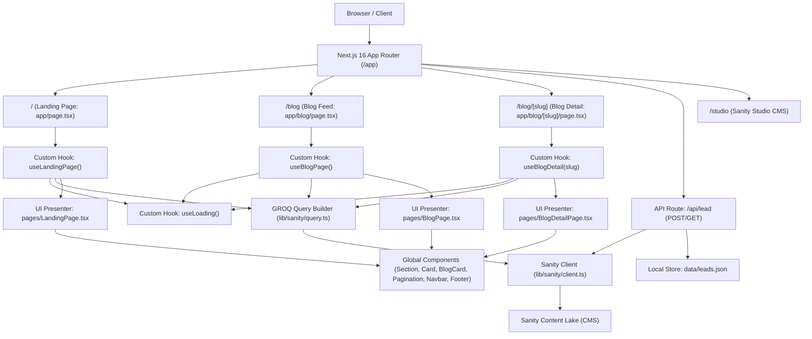

# Kodeva — Landing Campaign, Blog & Mini Marketplace

[Link deploy] | [Link CMS admin](/studio) | [Link repo]

## 1. Waktu Pengerjaan

| Bagian                                                                | Estimasi | Aktual    |
| --------------------------------------------------------------------- | -------- | --------- |
| Setup & CMS                                                           | 1 jam    | 1 jam     |
| Landing Page UI Components                                            | 1 jam    | 1 jam     |
| Integrasi CMS ke Blog, Dynamic Routing & Hooks                        | 1 jam    | 1 jam     |
| Integrasi CMS ke Landing Page, Produk Unggulan, Testimoni, FAQ & Lead | 1 jam    | 1 jam     |
| Marketplace Frontend, Cart & Payment Simulation                       | 2 jam    | 2 jam     |
| Tracking, UTM, Lighthouse                                             |          |           |
| Dokumentasi                                                           | 30 mnt   | 30 mnt    |
| **Total**                                                             |          | **6.5 jam** |

## 2. Akun Demo

| Peran     | URL       | Email | Password       |
| --------- | --------- | ----- | -------------- |
| CMS admin | `/studio` |       | (Sanity Login) |

## 3. Cara Menjalankan di Lokal

- Prasyarat: Node.js (>= 18.x atau 20.x), npm
- `git clone <repo-url>`
- `cp .env.example .env` (atau buat file `.env`):
  - `NEXT_PUBLIC_SANITY_PROJECT_ID`: f3djuv8n
  - `NEXT_PUBLIC_SANITY_DATASET`: Dataset Sanity `kodeva_local`
  - `NEXT_PUBLIC_SANITY_API_VERSION`: Versi API Sanity (`2026-10-29`)
  - `NEXT_PUBLIC_APP_NAME`: Nama Brand/Aplikasi (default: `Kodeva`)
  - `SANITY_API_TOKEN`: (Opsional) Token autentikasi Sanity write untuk lead capture
- `npm install`
- `npm run dev`
- Akses website di `http://localhost:3000`
- Akses halaman blog di `http://localhost:3000/blog`
- Akses CMS Studio di `http://localhost:3000/studio`
- Akses data lead marketing di `http://localhost:3000/api/lead`
- Pengecekan tipe TypeScript: `npx tsc --noEmit`
- Linter kode: `npm run lint`

## 4. Arsitektur & Alasan Memilih Stack

- Diagram Arsitektur Aplikasi:



- Tabel keputusan:

| Kebutuhan             | Pilihan                             | Alasan                                                                | Alternatif yang dipertimbangkan |
| --------------------- | ----------------------------------- | --------------------------------------------------------------------- | ------------------------------- |
| Framework             | Next.js 16 (App Router)             | Server & Client Components, performa tinggi, dynamic routes `[slug]`  | Vite, Remix                     |
| CMS                   | Sanity CMS v3 (`next-sanity`)       | Schema as code, headless, fleksibel, embed studio di route `/studio`  | Strapi, Contentful              |
| Database              | Sanity Content Lake                 | Terintegrasi langsung dengan CMS, query GROQ yang cepat & fleksibel   | PostgreSQL, MongoDB             |
| Lead Capture Storage  | Dual-Write (Sanity + Local JSON)    | Tim marketing dapat melihat leads di Studio maupun via endpoint JSON  | SQLite, Google Sheets           |
| Query Builder         | Custom Fluent GROQ `Query` Builder  | Type-safe, chaining API mirip ORM (`where`, `orderBy`, `paginate`)    | Raw GROQ string manual          |
| State Management / UI | Custom Hooks (`useLoading`, dll.)   | Pemisahan logika data dari komponen presentasi (_Clean Architecture_) | Redux, Zustand                  |
| UI library            | Tailwind CSS v4 + Custom Components | Kontrol penuh styling, performa tinggi tanpa runtime overhead         | Shadcn UI, Chakra UI            |

### Strategi Caching & Revalidation

- **Strategi yang Diterapkan**:
  - Konfigurasi Sanity client pada [`lib/sanity/client.ts`](file:///c:/Sadam/work/My%20Self/kodeva/lib/sanity/client.ts) menggunakan `useCdn: false` dengan pengambilan data secara dinamis (_Client-Side Rendering_ dengan custom hooks `useLandingPage`, `useBlogPage`, dan `useBlogDetail`).
- **Waktu Perubahan Tampil di Website**:
  - **Seketika (0 detik setelah publish)**: Setiap kali user me-refresh atau mengunjungi halaman website, kueri GROQ langsung diarahkan ke Sanity Content Lake live API endpoint, sehingga artikel, produk, hero banner, testimoni, atau FAQ yang baru saja di-_publish_ oleh user non-teknis di `/studio` langsung muncul seketika di website tanpa memerlukan _build_ ulang ataupun _manual deployment_.
- **Konsekuensi Latensi vs Cache**:
  - _Kelebihan_: Konten selalu 100% konsisten, terhindar dari _stale content_, dan tim marketing/konten langsung dapat memverifikasi hasil revisi secara langsung (_instant feedback_).
  - _Konsekuensi_: Terdapat sedikit latensi jaringan untuk melakukan permintaan ke server Sanity saat pertama kali dibuka. Untuk memitigasi hal ini, aplikasi dilengkapi dengan animasi _skeleton pulse loader_ halus dan sistem _fallback state_ instan sehingga tata letak visual tetap stabil (_zero layout shift / CLS_).
  - _Alternatif untuk Skala Tinggi_: Untuk trafik jutaan pengunjung, dapat diaktifkan Sanity Webhook on-demand revalidation (`revalidateTag`) di Server Components sehingga data di-cache di Edge CDN dan hanya di-_purge_ ketika webhook mendeteksi event publish dari Sanity.

- Struktur folder:

```text
kodeva/
├── app/
│   ├── api/
│   │   └── lead/route.ts     # Endpoint lead capture (validasi & proteksi spam)
│   ├── blog/
│   │   ├── [slug]/page.tsx   # Rute dinamis detail artikel blog
│   │   └── page.tsx          # Rute feed daftar artikel blog
│   ├── studio/[[...tool]]/   # Sanity Studio CMS
│   ├── globals.css           # Konfigurasi Tailwind CSS v4 & theme
│   ├── layout.tsx            # Root layout
│   └── page.tsx              # Landing page utama
├── components/
│   ├── BlogCard.tsx          # Kartu artikel responsif
│   ├── Card.tsx              # Kartu serbaguna (radius, border, bgImage)
│   ├── Footer.tsx            # Footer global 4 kolom
│   ├── Navbar.tsx            # Navbar dengan tema dark/light & mobile drawer
│   ├── Pagination.tsx        # Komponen navigasi pagination
│   └── Section.tsx           # Wrapper section dengan min-height responsif
├── data/
│   └── leads.json            # Arsip data lead capture untuk tim marketing
├── enums/
│   ├── card.enum.ts          # Enum opsi Card
│   ├── lead.enum.ts          # Enum status lead & tipe kontak
│   ├── post.enum.ts          # Enum status draft/publish post
│   └── product.enum.ts       # Enum badge produk unggulan
├── hooks/
│   ├── useBlogDetail.ts      # Logika fetch detail artikel & artikel rekomendasi
│   ├── useBlogPage.ts        # Logika fetch feed artikel, pagination & sidebar
│   ├── useCard.ts            # Logika komputasi style Card
│   ├── useLandingPage.ts     # Logika landing page, accordion FAQ & lead capture
│   ├── useLoading.ts         # Hook reusable untuk manajemen status loading/error UI
│   └── usePaginate.ts        # Hook pagination kalkulasi halaman
├── lib/
│   └── sanity/
│       ├── client.ts         # Inisialisasi Sanity Client (read & write)
│       └── query.ts          # Fluent GROQ Query Builder
├── pages/
│   ├── BlogDetailPage.tsx    # Presenter view detail artikel & PortableText
│   ├── BlogPage.tsx          # Presenter view feed artikel & sidebar
│   └── LandingPage.tsx       # Presenter view Landing Page lengkap 5 section
├── types/
│   ├── card.type.ts          # Interface props Card
│   ├── category.type.ts      # Interface skema & item kategori
│   ├── faq.type.ts           # Interface FAQ
│   ├── landing.type.ts       # Interface data hero & landing page
│   ├── lead.type.ts          # Interface form lead capture & errors
│   ├── loading.type.ts       # Interface state & handler useLoading
│   ├── paginate.type.ts      # Interface Pagination
│   ├── post.type.ts          # Interface skema artikel, feed item, & detail item
│   ├── product.type.ts       # Interface produk marketplace
│   ├── sanity.type.ts        # Definisi tipe dokumen Sanity
│   └── testimonial.type.ts   # Interface testimoni klien
└── sanity/
    ├── env.ts                # Helper env Sanity
    ├── structure.ts          # Desk structure Sanity Studio
    └── schemaTypes/          # Skema post, category, blockContent, hero, product, testimonial, faq, lead
```

## 5. Status Pengerjaan

### ✅ Selesai

- [x] Setup Next.js 16 App Router & Tailwind CSS v4
- [x] Integrasi Sanity Studio CMS mounted di route `/studio`
- [x] Pembuatan Schema Sanity CMS dengan validasi field & SEO:
  - [x] `postType.ts` (judul, slug, cover, rich text, kategori, status draft/publish, link produk marketplace)
  - [x] `categoryType.ts` (title, slug, description)
  - [x] `blockContentType.ts` (Portable rich text)
  - [x] `heroType.ts` (badge, title, subtitle, background image, CTA text, CTA link)
  - [x] `productType.ts` (title, slug, price, original price, cover, badge, isFeatured, rating, demoUrl)
  - [x] `testimonialType.ts` (name, role, company, avatar, content, rating 1-5)
  - [x] `faqType.ts` (question, answer, order)
  - [x] `leadType.ts` (name, contact, contactType, message, status, submittedAt)
- [x] Komponen Global Reusable:
  - [x] `Section.tsx` (Auto 100vh / min-h-screen)
  - [x] `Card.tsx` (Fleksibilitas border, radius kustom, background image & overlay)
  - [x] `Navbar.tsx` (Tema dark/light, efek glassmorphism on-scroll, responsif mobile drawer)
  - [x] `Footer.tsx` (Brand bio, navigasi multi-kolom, copyright & terms)
  - [x] `BlogCard.tsx` (Kartu artikel editorial tanpa author)
  - [x] `Pagination.tsx` (Navigasi halaman dinamis)
- [x] Halaman Landing Page (`/`):
  - [x] **Section 1: Hero Section** (judul, subjudul, gambar cover dinamis, tombol CTA ke katalog produk)
  - [x] **Section 2: Daftar Produk Unggulan** (grid kartu produk dari CMS dengan harga, badge, rating, dan CTA beli)
  - [x] **Section 3: Testimoni Klien** (kartu testimoni dari CMS dengan avatar, rating bintang, nama, dan perusahaan)
  - [x] **Section 4: FAQ Section** (accordion interaktif buka-tutup dengan animasi smooth)
  - [x] **Section 5: Form Lead Capture** (input nama, email/WhatsApp, validasi format, proteksi spam honeypot, feedback sukses)
  - [x] Data lead tersimpan untuk tim marketing (`/api/lead` dan `data/leads.json`)
  - [x] Semua konten dapat diedit oleh user non-teknis lewat Sanity Studio (`/studio`)
- [x] Integrasi CMS ke Blog & Dynamic Routing:
  - [x] Pembuatan Fluent GROQ Query Builder (`lib/sanity/query.ts`)
  - [x] Custom Hook `useLoading` untuk status loading, error handling, dan reset
  - [x] Halaman Blog Feed (`/blog`):
    - [x] Hero Card dinamis dari artikel featured terbaru
    - [x] Feed artikel dengan navigasi pagination interaktif
    - [x] Widget sidebar dinamis: Most Viewed & Categories
    - [x] Animasi skeleton loading pulse
  - [x] Halaman Detail Blog Berbasis Slug (`/blog/[slug]`):
    - [x] Rute dinamis App Router Next.js 16
    - [x] Pengambilan artikel spesifik berdasarkan `slug.current`
    - [x] Rendering konten rich text `PortableText`
    - [x] Widget sidebar artikel rekomendasi lainnya
    - [x] Navigasi kembali ke halaman utama blog
- [x] Mini Marketplace Frontend:
  - [x] Katalog Produk (`/products`):
    - [x] 6 Produk aplikasi & starter kit lengkap dengan mock API (`/api/products`)
    - [x] Filter multi-kategori pills (Kasir POS, SaaS Starter, SDM, E-Commerce, Edu-Tech, Properti)
    - [x] Pencarian langsung (live search) berdasarkan judul & deskripsi
    - [x] Pengurutan (sorting): Unggulan, Harga Terendah, Harga Tertinggi
  - [x] Halaman Detail Produk (`/products/[slug]`):
    - [x] Galeri screenshot fitur produk yang interaktif
    - [x] Selector paket tier (Basic, Pro, Business) yang langsung mengubah harga, lisensi, dan fitur
    - [x] Penampilan harga coret saat promo
    - [x] Counter sisa kuota promo real-time (otomatis dikurangi jumlah di keranjang)
    - [x] Tombol "Tambah ke Keranjang" & "Beli Sekarang"
  - [x] Keranjang Belanja Interaktif (`/cart`):
    - [x] Tambah, ubah jumlah lisensi per tier, dan hapus item
    - [x] Perhitungan otomatis subtotal, diskon promo, dan grand total
    - [x] Persistensi data keranjang di `localStorage` (tetap ada saat refresh)
    - [x] Aturan kuota promo lintas-tier: jika beberapa paket dari produk yang sama ada di keranjang, batas kuota promo dihitung terhadap total akumulasi lisensi produk tersebut
    - [x] Peringatan alert interaktif jika kuota promo terlampaui
    - [x] Tombol "Kosongkan Keranjang" dan navigasi kembali belanja
  - [x] Checkout & Simulasi Pembayaran (`/checkout`):
    - [x] Form data pembeli (Nama min. 3 huruf, Email valid, WhatsApp opsional) dengan validasi instan
    - [x] Pilihan metode pembayaran simulasi: QRIS, BCA VA, Mandiri VA, Kartu Kredit
    - [x] Saklar Simulator Pembayaran: Sukses vs Gagal
    - [x] Indikator status processing (~1.5 detik)
    - [x] Penanganan error saat simulasi gagal dengan tombol coba lagi
    - [x] Tampilan Faktur / Bukti Bayar Sukses dengan status lunas hijau, nomor order unik, rincian biaya, tombol cetak bukti, dan generator serial lisensi unik untuk setiap lisensi yang dibeli
  - [x] State Management UI:
    - [x] Status loading skeleton animasi
    - [x] Status error penanganan mock API
    - [x] Status kosong (empty cart dengan CTA jelajah produk, produk tidak ditemukan)
  - [x] Mobile Friendly Experience:
    - [x] Touch target luas dan nyaman ditekan di HP
    - [x] Cart counter badge dinamis di Navbar
    - [x] Floating Mobile Cart Button di pojok kanan bawah yang selalu mudah diakses dari halaman mana pun
- [x] Standar Kode (_Clean Architecture_):
  - [x] Pemisahan logika di `hooks/`, interface di `types/`, enum di `enums/`, presenter di `pages/`, rute di `app/`
  - [x] Urutan hook: `useState` &rarr; custom hooks &rarr; lifecycle hooks &rarr; functions ber-prefix `handle`
  - [x] Bebas komentar kode (_clean code_)

### ⚠️ Belum Selesai / Tahap Selanjutnya

- [ ] Integrasi backend live database & Webhook Payment Gateway (Midtrans/Xendit)
- [ ] Tracking analitik, dataLayer events, dan atribusi UTM
- [ ] Audit performa Google Lighthouse Mobile

## 6. Library, Template & Tools Pihak Ketiga

| Nama               | Fungsi                     | Alasan dipakai                                                  |
| ------------------ | -------------------------- | --------------------------------------------------------------- |
| `next` (v16)       | Core Framework React       | App Router modern, Server & Client Components, dynamic routing  |
| `sanity` (v6)      | Headless CMS               | CMS fleksibel dengan konfigurasi skema berbasis kode TypeScript |
| `next-sanity`      | Integrasi Next.js & Sanity | Sanity Studio route & rendering PortableText component          |
| `@sanity/vision`   | Plugin GROQ Playground     | Memudahkan pengujian query GROQ langsung di dalam Studio        |
| `@sanity/client`   | Sanity Data Client         | Pengambilan data konten dari Sanity Content Lake                |
| `tailwindcss` (v4) | Utility-first CSS          | Styling modern, responsif, cepat dan minim overhead             |

## 7. Rencana Integrasi Marketplace ke Backend

### Endpoint yang dibutuhkan

- `GET /api/products`: Mengambil katalog produk, kategori, dan stok
- `GET /api/products/[slug]`: Mengambil spesifikasi lengkap dan lisensi produk
- `POST /api/checkout`: Memvalidasi keranjang belanja dan membuat pesanan baru
- `POST /api/webhooks/payment`: Menerima notifikasi status pembayaran dari payment gateway

### Alur Payment Gateway yang Aman

1. Client mengirim payload keranjang belanja ke server (`/api/checkout`).
2. Server memvalidasi harga asli dan stok dari database/Sanity (bukan mempercayai harga dari client).
3. Server memanggil API payment gateway (Midtrans / Xendit / Stripe) menggunakan _secret server key_.
4. Payment gateway mengembalikan token pembayaran / Snap redirect URL ke client.
5. Client menyelesaikan pembayaran pada widget gateway.
6. Webhook server memverifikasi signature resmi gateway sebelum memperbarui status pesanan menjadi lunas.

### Menjaga Kuota Promo Tetap Akurat

- Menerapkan mekanisme atomic update / row-level lock pada database transaksi saat promo digunakan untuk menghindari _race condition_ (over-claiming).

### Pengiriman Lisensi Setelah Pembayaran

- Setelah webhook payment terverifikasi lunas, sistem secara otomatis men-generate kunci lisensi unik dan mengirimkannya via email transaksional (Resend/SendGrid) serta menampilkan di halaman sukses pesanan.
